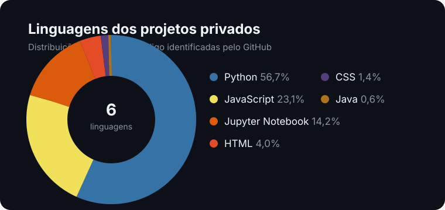

# Olá, eu sou o Guilherme Carvalho 👋

**Desenvolvedor em formação, construindo projetos e aprendendo todos os dias.**

## 📊 Dashboard de linguagens

  

> Baseado nos arquivos reconhecidos pelo GitHub nos seus repositórios **privados**. Atualizado em novembro de 2026.

  

| Linguagem | Participação nos arquivos analisados |
| --- | --- |
| Python | ███████████░░░░░░░░░ 56,7% |
| JavaScript | █████░░░░░░░░░░░░░░░ 23,1% |
| Jupyter Notebook | ███░░░░░░░░░░░░░░░░░ 14,2% |
| HTML | █░░░░░░░░░░░░░░░░░░░ 4,0% |
| CSS | ▎░░░░░░░░░░░░░░░░░░░ 1,4% |
| Java | ▏░░░░░░░░░░░░░░░░░░░ 0,6% |

## 🧰 Tecnologias já utilizadas

Pelos repositórios privados, trabalhei com:

  
  
  
  
  
  
  
  
  
  
  

_A análise é agregada: nenhum nome ou conteúdo de repositório privado é exposto neste perfil público._

_Obrigado pela visita!_ ✨

